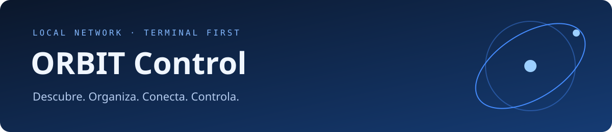

<p align="center">
  
</p>

<p align="center">
  
  
  
  
</p>

**ORBIT Control** reúne descubrimiento de televisores, inventario y control remoto en una aplicación de terminal. Crea perfiles, encuentra anuncios de equipos en tu red y abre un mando visual azul desde el mismo inventario.

El proyecto está orientado a redes locales y uso diario: reutiliza las autorizaciones Samsung guardadas, mantiene abierta la sesión de control y registra la última conexión de cada equipo.

[Instalación](#instalación) · [Uso diario](#uso-diario) · [Compatibilidad](#compatibilidad) · [Permisos y datos locales](#permisos-y-datos-locales) · [Solución de problemas](#solución-de-problemas)

## Qué puedes hacer

- **Gestionar controles:** crear, consultar, editar y eliminar perfiles con nombre, IP, marca y modelo.
- **Descubrir equipos:** utilizar el TShark de tu sistema o importar capturas `.pcap` / `.pcapng`.
- **Controlar desde la terminal:** navegación, volumen, canales y reproducción con teclado o clics opcionales.
- **Reutilizar autorizaciones:** conservar los tokens Samsung entre sesiones, mientras el TV los mantenga válidos.
- **Personalizar el acceso:** abrir el inventario con **Super+N** en COSMIC mediante un instalador que conserva los otros atajos.

## Compatibilidad

| Plataforma | Descubrimiento e identificación | Control implementado | Autorización |
|---|---|---|---|
| **Samsung Smart TV compatible** | Anuncios UDP 8001, SSDP y consulta de metadatos locales | WebSocket en 8002 / 8001; navegación, volumen, canales y reproducción | Aprobación en el TV y reutilización del token local |
| **Roku TV / reproductor Roku** | Anuncios SSDP y consulta ECP | Envío de teclas mediante ECP | Acceso por aplicaciones habilitado en el equipo |
| **LG webOS** | Reconocimiento de anuncios SSDP | Pendiente de adaptador | No implementada |

La disponibilidad de cada botón depende del modelo. Detectar un anuncio no confirma una autorización ni garantiza compatibilidad de control. Algunos dispositivos Roku son reproductores, no televisores.

## Requisitos

- Python **3.10 o superior** y una terminal con `curses` y soporte de colores.
- **Linux** es el entorno principal. El atajo Super+N requiere **COSMIC** y `cosmic-term`.
- **TShark del sistema** para captura o lectura de archivos Wireshark. El mando de un TV ya guardado no necesita capturar tráfico.
- Comunicación local entre computadora y televisor. El aislamiento de clientes, las redes de invitados y los firewalls pueden impedirla.

## Instalación

```sh
git clone https://github.com/090Santander/orbit-control.git
cd orbit-control
python3 -m venv .venv
.venv/bin/python -m pip install -r requirements.txt
./orbit
```

Estos comandos funcionan en Fish, Bash y Zsh sin activar el entorno virtual. Las dependencias Python se instalan en `.venv`; Wireshark/TShark se instala y configura mediante el sistema operativo.

## Uso diario

```text
Inventario visual → Seleccionar equipo → Enter → Mando remoto → Q → Inventario
```

### Inventario visual

El inicio predeterminado abre **Mis controles remotos**.

| Tecla | Acción |
|---|---|
| `N` | Crear perfil con nombre, IP y marca |
| `E` | Editar el perfil seleccionado |
| `D` | Eliminar la ficha después de confirmar con `SI` |
| `B` | Buscar anuncios usando el Wireshark/TShark del sistema |
| `I` | Importar una captura `.pcap` o `.pcapng` |
| `F` / `Esc` | Filtrar equipos / limpiar filtro |
| `↑` / `↓` | Seleccionar un perfil |
| `Enter` | Abrir su control remoto |
| `Q` | Cerrar la aplicación |

Puedes pegar direcciones IP y rutas en los formularios. `Ctrl+U` limpia un campo y `Esc` cancela el formulario.

### Mando remoto

| Tecla | Control |
|---|---|
| Flechas / `Enter` | Navegar / aceptar |
| `H` / `B` o `Esc` | Inicio / atrás |
| `+` / `−` / `M` | Volumen / silencio |
| `[` / `]` | Canal anterior / siguiente |
| Espacio | Reproducir / pausar |
| `R` | Reconectar |
| `T` | Activar o desactivar clics del ratón |
| `Q` | Volver al inventario |

A partir de **78 columnas × 26 filas**, el mando muestra cruceta, botones y paneles de sesión y actividad. En tamaños menores utiliza una vista compacta. Los clics están desactivados inicialmente para permitir seleccionar y copiar texto en la terminal.

### Otros modos

```sh
./orbit --terminal                       # Samsung guardado, acceso directo
./orbit --terminal --ip 192.168.1.50      # Samsung por IP
./orbit --shell                          # Prompt de comandos
./orbit --web                            # Interfaz HTML local opcional
```

En modo web, abre la URL que imprime la terminal. Si el puerto predeterminado está ocupado, ORBIT busca otro disponible.

### Super+N en COSMIC

```sh
.venv/bin/python scripts/install-shortcut.py          # Vista previa
.venv/bin/python scripts/install-shortcut.py --apply  # Instalar
```

El instalador crea una copia de seguridad de los atajos personalizados y rechaza un conflicto en Super+N. El acceso utiliza COSMIC Terminal y apunta a la carpeta actual del proyecto; si la mueves, debes revisar o reinstalar ese atajo. Si COSMIC no recoge el cambio de inmediato, vuelve a iniciar sesión.

## Descubrimiento con Wireshark

ORBIT ejecuta el **binario `tshark` instalado en tu sistema**. La captura en vivo dura ocho segundos y escucha:

| Transporte | Uso |
|---|---|
| UDP **8001** | Anuncios Samsung con referencias a sus API locales |
| UDP **1900** | Anuncios SSDP de equipos Samsung, Roku y LG compatibles |

La búsqueda registra candidatos y, cuando es posible, consulta nombre y modelo por HTTP local. No solicita autorización automáticamente. La captura es pasiva: solo observa anuncios que llegan a la interfaz seleccionada, por lo que puede no encontrar todos los equipos.

El modo shell permite elegir interfaz, importar archivos y administrar el inventario:

```text
interfaces
buscar
buscar wlan0
importar "capturas/red-local.pcapng"
equipos
agregar 192.168.1.50 samsung
ver 1
editar 1 Televisor sala
control 1
eliminar 1
salir
```

La lectura de capturas está limitada a 2000 paquetes. Una captura histórica no demuestra que la IP siga perteneciendo al mismo equipo. En el CRUD visual, la búsqueda se inicia con `B`; en el modo shell se realiza una búsqueda inicial si no existe inventario ni una IP guardada.

## Permisos y datos locales

Los datos de ejecución se mantienen en `.data/`, **excluida de Git**:

```text
.data/
├── inventory.sqlite3   # Perfiles, alias y fechas de actividad
├── tv.json             # Última IP y puerto Samsung autorizados
└── tokens/             # Tokens privados emitidos por los televisores
```

La primera conexión Samsung puede solicitar aprobación de **ORBIT Remoto** en pantalla. Las siguientes reutilizan el token existente. La autorización puede caducar o ser revocada por el televisor; ORBIT no garantiza un permiso permanente.

Editar un alias o eliminar una ficha no elimina los tokens. Cambiar la IP de un perfil no traslada la autorización a otro dispositivo. Si DHCP reasigna direcciones, revisa la ficha antes de conectar.

Conserva una copia privada de `.data/` si reinstalas. Los tokens, las bases locales, `.venv` y las capturas de red están excluidos mediante [`.gitignore`](.gitignore). No los adjuntes a incidencias ni a cambios del repositorio.

## Solución de problemas

| Problema | Qué revisar |
|---|---|
| La búsqueda devuelve cero equipos | Selecciona la interfaz correcta, enciende el TV o crea el perfil por IP. Puede no haber anuncios durante esos ocho segundos. |
| TShark informa permisos insuficientes | Configura los permisos de captura de Wireshark para tu usuario desde el sistema. ORBIT no eleva privilegios. |
| Samsung vuelve a pedir permiso | Acepta ORBIT Remoto y revisa los ajustes de acceso del TV. Comprueba que sigues conservando `.data/`. |
| Un botón Roku falla | Verifica el acceso por aplicaciones y que el modelo admita esa tecla. |
| El canal se desconecta | Pulsa `R`. Los comandos fallidos no se repiten automáticamente. |
| LG aparece pero no abre un mando | El adaptador de control LG todavía está pendiente. |

Un envío completado no confirma por sí solo un cambio físico en la pantalla. Al salir, la aplicación puede esperar a que termine una solicitud de conexión en curso.

## Desarrollo y validación

```sh
.venv/bin/python -m unittest discover -s tests -v
```

Las pruebas comprueban el CRUD, la conservación de alias y tokens, el reconocimiento de anuncios Samsung UDP 8001 y el manejo de sesiones autorizadas o rechazadas con adaptadores simulados. El lector se comprobó además contra una captura real usando TShark del sistema. La compatibilidad física debe verificarse con cada modelo de TV.

```text
app.py          Adaptador Samsung, permisos, argumentos y servidor web
manager.py      Inventario visual de terminal
terminal.py     Mando remoto azul
console.py      Prompt de comandos
inventory.py    Persistencia SQLite y CRUD
discovery.py    Captura e identificación con TShark
roku.py         Adaptador Roku ECP
scripts/        Lanzador COSMIC e instalador del atajo
tests/          Pruebas de inventario y sesiones
```

Para contribuir, incluye los pasos para reproducir el problema y la marca/modelo del equipo. Oculta direcciones o identificadores que no quieras compartir y conserva los tokens fuera del reporte.
